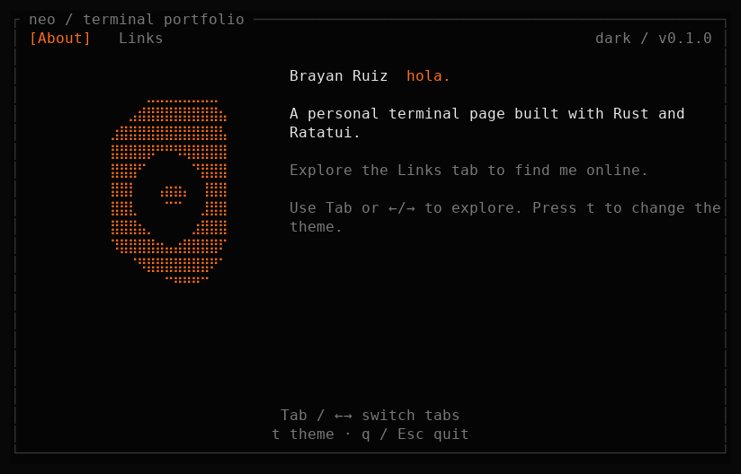
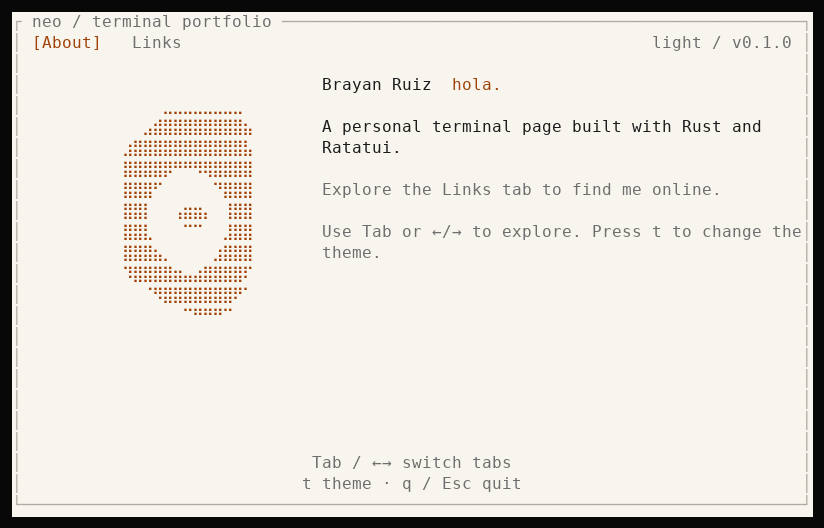
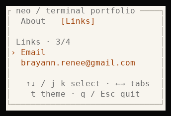

# Terminal Portfolio

**A personal portfolio, one terminal window away.**

Built with Rust and Ratatui, Terminal Portfolio brings a profile, portrait, and
links into a keyboard-driven interface. Switch tabs, change themes, and explore
without leaving your terminal.

[](https://github.com/neohe-imer/terminal-portfolio/actions/workflows/ci.yml)
[](LICENSE)

[Quick start](#quick-start) · [Controls](#controls) · [Customize](#customize) · [Development](#development)

## Preview

**Dark theme · 80 × 24**



<details>
<summary>Light theme and compact layout</summary>

**Light theme · 80 × 24**



**Compact Links tab · 32 × 10**



</details>

Previews render the application's terminal output; font appearance depends on
your terminal.

## What it does

- **Adapts to your window.** A centered panel on large displays, a compact layout
  down to 32 columns × 10 rows, and resize guidance below that size.
- **Keeps navigation visible.** Scrollable links follow the selected entry, with
  a position indicator and controls for the current tab.
- **Offers two themes.** Toggle between dark and light palettes with `t`.
- **Fits the portrait to the space.** Wide, tall windows show the Unicode portrait;
  smaller windows prioritize the profile text.
- **Restores your terminal.** Cleanup handles normal exits, returned errors,
  partial setup failures, and panics.

## Quick start

You'll need Git, a stable [Rust toolchain](https://rustup.rs/) with Cargo, and an
interactive terminal. A Unicode-capable font and true-color support give the best
appearance. Start with an 80 × 24 window to see the portrait and profile together.

```sh
git clone https://github.com/neohe-imer/terminal-portfolio.git
cd terminal-portfolio
cargo run --locked
```

For an optimized build:

```sh
cargo run --release --locked
```

The app starts on **About** in the dark theme. Press `Tab` to explore links,
`t` to change the theme, and `q` to return to your shell.

## Controls

| Key | Action |
| --- | --- |
| `h` / `←` | Show About |
| `l` / `→` | Show Links |
| `Tab` / `Shift+Tab` | Switch tabs |
| `j` / `↓` | Select the next link on Links |
| `k` / `↑` | Select the previous link on Links |
| `t` | Toggle dark/light theme |
| `q` / `Esc` / `Ctrl+C` | Quit |

Selection stops at the first and last link. Links are displayed for reference;
selecting one does not open a browser. The resume entry is currently a placeholder.

## Customize

The profile is defined in [src/main.rs](src/main.rs). Edit the relevant section,
then run `cargo run --locked` to rebuild and preview your changes.

| What to change | Where to edit |
| --- | --- |
| Name, greeting, and biography | `App::render_about` |
| Link labels and destinations | The `links` vector in `App::default` |
| Portrait | `portrait_text` |
| Theme colors | `impl From<ThemeMode> for Palette` |
| Window title | The window block in `App::render` |

Profile changes are made in source; there is no external configuration file or
persistent theme setting. When editing text or links, check both 80 × 24 and
32 × 10 layouts so longer content remains readable.

## Development

Run the same checks used in CI:

```sh
cargo fmt --check
cargo clippy --locked --all-targets -- -D warnings
cargo test --locked
```

CI runs on Linux, macOS, and Windows. The regression suite covers keyboard input,
selection bounds and visibility, both themes, and zero-sized through large
terminal layouts. `Cargo.lock` is tracked to keep dependency resolution repeatable.

### Project layout

| File | Responsibility |
| --- | --- |
| [src/main.rs](src/main.rs) | App state, input handling, layout, profile, and themes |
| [src/terminal.rs](src/terminal.rs) | Terminal setup, cleanup, and panic hook |
| [src/tests.rs](src/tests.rs) | Input and rendering regression tests |
| [Cargo.toml](Cargo.toml) | Package metadata and dependencies |
| [.github/workflows/ci.yml](.github/workflows/ci.yml) | Formatting, lint, and test checks |

### Contributing

Bug reports and focused pull requests are welcome. For a UI issue, include your
operating system, terminal emulator, window size, and steps to reproduce it.
For layout changes, include before/after previews and check both themes at compact
and standard sizes. Run the development checks before opening a PR.

## Running over SSH

You can launch the app inside an existing interactive SSH session on a machine
where it is installed. This repository does not include an SSH server or a public
portfolio endpoint.

## License

[MIT](LICENSE).
